# SchoolERP Fees & Concession Module — Architecture & Complete Flow Map

**Prepared from:** uploaded `src(2).zip`, current Fees & Concession Notion pages, and the billing decisions confirmed in this conversation.  
**Code snapshot reviewed:** uploaded source ZIP (not a live repository checkout).  
**Requirements source:** Notion `New Requirement`, `Schema`, `Documentation`, `Builders/Helpers Documentation`, `Student Fees`, and `Future Consideration` pages.

> **How to read this document**  
> **Implemented** = found in the uploaded source code. **Partial** = some code exists, but important behavior or wiring is missing/inconsistent. **Deferred** = explicitly outside the current phase or listed as future. **Mismatch** = the Notion requirement and current source code do not agree. **Newly agreed** = a rule agreed in this chat; it is not yet implemented in the uploaded ZIP.

---

## 1. First understand the module in one picture

Fees is not one giant feature. It is a set of smaller responsibilities that work together:

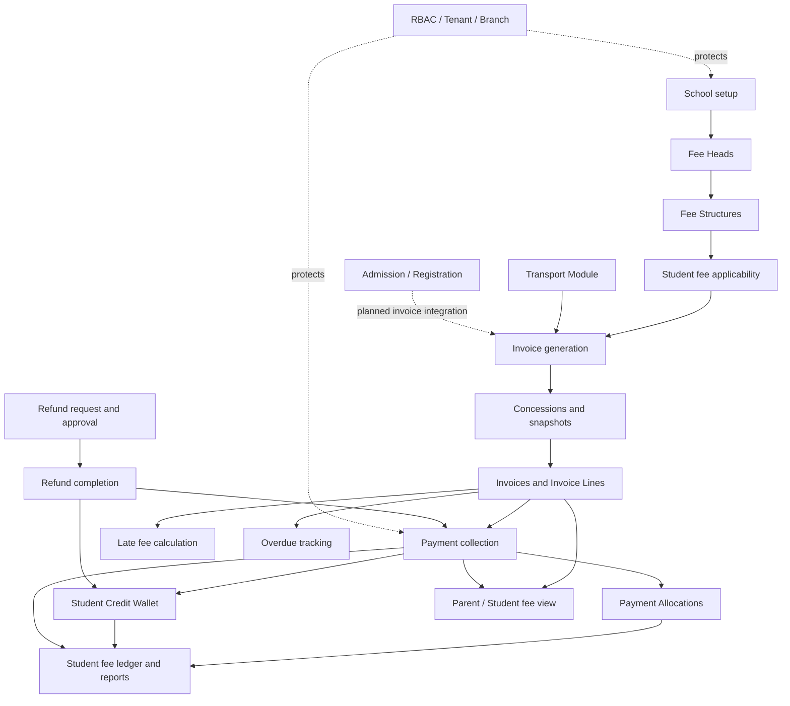

**In simple words:** Fee Head defines *what to charge*. Fee Structure defines *who gets charged and how much*. Invoice is the bill. Payment is the money received. Payment Allocation connects money to one or more bills. Wallet stores money not yet allocated to a bill. Concession reduces a bill. Late Fee adds a separate charge. Refund returns money. Reports and portals read these records.

---

## 2. Modular separation of concerns — which layer owns what?

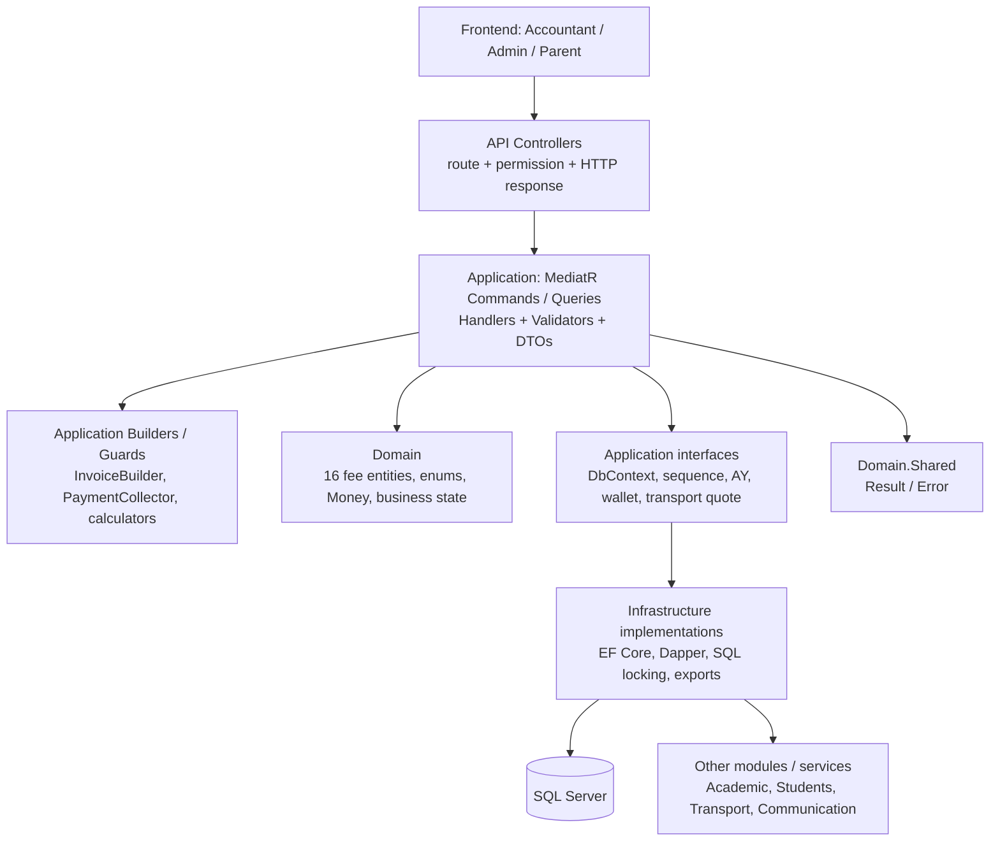

| Layer / area | Responsibility | Examples in the ZIP |
|---|---|---|
| API | HTTP routes, permission attributes, request/response | `Controllers/Fees/*Controller.cs` |
| Application Commands | Writes and state transitions | `CreateFeeHead`, `GenerateStudentInvoice`, `CollectPayment`, `ApproveRefund` |
| Application Queries | Reads, lists, details, reports | `GetInvoices`, `GetStudentFeeCounter`, `GetStudentLedger` |
| Validators | Validate command/request shape before handler work | `*CommandValidator.cs` beside command |
| Builders | Reusable business calculation/orchestration; no direct endpoint concerns | `InvoiceBuilder`, `PaymentCollector`, `ConcessionCalculator`, `LateFeeCalculator` |
| Guards | Tenant / branch / parent-child / billing checks | `FeeScopeGuard`, `ParentChildResolver` |
| Domain | Persisted business concepts and state | `Invoice`, `Payment`, `FeeStructure`, `Concession`, `Refund` |
| Infrastructure | Database, concurrency, sequence, external integrations, exports | `FeeSequenceGenerator`, `WalletLedgerWriter`, `TransportFeeQuoteProvider`, `ClosedXmlExportService` |
| Shared | Consistent success/failure result | `Result<T>`, `Error`, `Money` |

### Builder / helper inventory — where reusable logic belongs

The uploaded ZIP contains 246 C# files under `Features/Fees`; this document maps the important files and responsibilities rather than reproducing every filename. The reusable builder/helper classes found in the source include:

| Builder / helper | Responsibility | Keep logic here |
|---|---|---|
| `InvoiceBuilder` | Resolve applicable structure and compose invoice + snapshot lines | Fee-line selection, billing-period amounts, concessions and invoice-line composition (coordinate with dedicated period/schedule services) |
| `PaymentCollector` | Validate and collect receipt allocations | Invoice-level allocation, payment status and finalization; do not put HTTP logic here |
| `ConcessionCalculator` | Calculate concessions for eligible fee lines | Discount calculation only; no persistence/endpoint concerns |
| `LateFeeCalculator` | Calculate late fee from frozen invoice-line rules | Late-fee calculation only |
| `ProrationCalculator` | Calculate proration | Reuse only after mid-period business rules are approved and wire it into invoice composition |
| `PeriodLabelBuilder` | Normalize/build period labels | Stable period identity; extend carefully for Q1–Q4/H1–H2/AY labels |
| `FeeScopeGuard` | Enforce fee tenant/branch scope | Shared scope validation, not duplicated per handler |
| `ParentChildResolver` | Verify parent-child access | Portal authorization only |
| `FeeSequenceGenerator` (Infrastructure service) | Atomic invoice/receipt numbering | SQL-specific sequence/locking only |
| `WalletLedgerWriter` (Infrastructure service) | Append wallet ledger movements safely | Wallet balance mutation and locking only |
| `CurrentAcademicYearProvider` (Infrastructure service) | Resolve current Academic Year | AY lookup; billing periods still derive from the selected AY's dates |
| `TransportFeeQuoteProvider` (Infrastructure service) | Quote student transport fee | Transport module lookup/quote; invoice builder consumes the quote |
| `ClosedXmlExportService` (Infrastructure service) | Excel export | File generation only |

Commands/queries are organized by feature folders (`FeeHead`, `FeeStructure`, `Invoice`, `Payment`, `Concession`, `Refund`, `Portal`, `Reports`). Handlers should orchestrate one use case and delegate reusable calculations/guards to builders/helpers. Do not move all business rules into `InvoiceBuilder`; the new schedule resolver and billing-period calculator should be separate reusable application services/builders.

### Main architectural rule

Controllers should not calculate invoice totals or mutate wallet balances. Controllers send a MediatR request. Application handlers coordinate the use case. Builders calculate reusable rules. Domain entities represent the financial records. Infrastructure performs database-specific work and locking.

---

## 3. Module map — responsibilities and actual code location

| Module | Owns | Actual folders / important classes | ZIP status |
|---|---|---|---|
| Fee Heads | Fee type master data: Tuition, Admission, Exam, Library, Transport, etc. | `Commands/FeeHead`, `Queries/FeeHead`, `FeeHeadsController`, `FeeHead` | Implemented; tax fields from older requirement are intentionally absent under the current no-tax Phase 1 rule |
| Fee Structures | Academic-year fee plan, scope, fee lines and frequency | `Commands/FeeStructure`, `Queries/FeeStructure`, `FeeStructuresController`, `FeeStructure`, `FeeStructureLine` | Implemented; recurring frequency selection is not wired into invoice builder |
| Student applicability | Current enrollment and automatic structure resolution / assignment override | `GetStudentAssignedStructure`, `AssignStudentFeeStructure`, `StudentEnrollment`, `StudentFeeAssignment` | Implemented for current structure resolution; future schedule/amount overrides remain a separate consideration |
| Concessions | Discount rules, student allocations, approval, sibling detection, usage history | `Commands/Concession`, `Queries/Concession`, `ConcessionsController`, `ConcessionCalculator` | Implemented / verify edge cases |
| Invoices | Single/bulk generation, detail, cancel, regenerate, manual line, adjustment, late fee, overdue | `Commands/Invoice`, `Queries/Invoice`, `InvoicesController`, `InvoiceBuilder` | Core manual flows implemented; new frequency and sequential rules are not in ZIP |
| Payments | Receipt, invoice allocation, CSV, advance, credit apply, transfer, cheque bounce | `Commands/Payment`, `Queries/Payment`, `PaymentsController`, `PaymentCollector` | Core manual flows implemented; pending cheque accounting needs careful review |
| Wallet | Advance / unallocated funds, credit adjustments, transfer, refund debit | `StudentCreditLedger`, `IWalletLedgerWriter`, `WalletLedgerWriter` | Implemented; manual credit apply exists; auto-apply and expiry job not wired |
| Late fees | Calculate from invoice-line snapshots, create/update late-fee lines, waive | `LateFeeCalculator`, `RecalculateLateFees`, `WaiveLateFee`, `LateFeeLog` | Partial; manual recalculation works, scheduler deferred; one extended monthly late-fee rule needs review |
| Refunds | Request, approve, reject, complete wallet or payment-linked refund | `Commands/Refund`, `Queries/Refund`, `RefundsController`, `Refund` | Partial; payment-linked completion does not appear to reverse invoice paid totals in the reviewed handler |
| Optional fees | Parent views optional heads and opts in | `Portal` commands/queries, `ParentFeesController`, `ParentChildResolver` | Implemented basic opt-in; deadlines / all recurrence variants need verification |
| Reports | Dashboard, outstanding, overdue, collection, concessions, credit, ledger, audit | `Queries/Reports`, `FeeReportsController` | Implemented Dapper read models; exports exist, PDF export not evidenced |
| Parent portal | Child fee view, bills, payment history / wallet, optional fee view | `ParentFeesController`, portal queries | Implemented read/opt-in flow; online gateway is deferred |
| Transport integration | Obtain transport quote for a student and append transport charge | `ITransportFeeQuoteProvider`, `TransportFeeQuoteProvider`, `InvoiceBuilder` | Partial; single and bulk invoice builders are not consistently wired; quote frequency is not currently filtered |
| Admission / Registration integration | Registration fee before admission; admission fee before first tuition bill | Student Registration / Admission commands and entities | Not integrated with Fees invoice/payment tables in the reviewed ZIP |
| Audit | Immutable financial audit trail | `FinancialAuditLog`, `IFinancialAuditWriter` | Partial/deferred: interface/entity exist; writer implementation and handler calls are incomplete |
| Scheduling | Scheduled recurring invoice, late-fee and overdue jobs | Hangfire package is present | Deferred / no corresponding fee jobs found in ZIP |

---

## 4. Setup flow — before the first student invoice

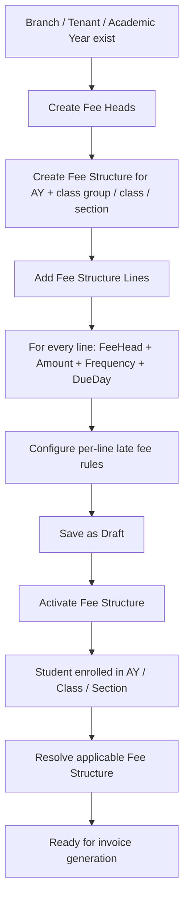

**Fee Structure matching order in the current builder:** active student assignment override → exact Class + Section → Class with no Section → ClassGroup structure. A student enrollment carries `AcademicYearId`, `ClassId`, `SectionId`, `EnrolledAt`, and optional `LeftAt`.

**ZIP detail:** `StudentEnrollment.EnrolledAt` is `DateOnly` (not `DateTime`); `LeftAt` is `DateOnly?`. Any implementation prompt assuming `DateTime` for those fields must be corrected.

---

## 5. Fee Head → Fee Structure → Student resolution

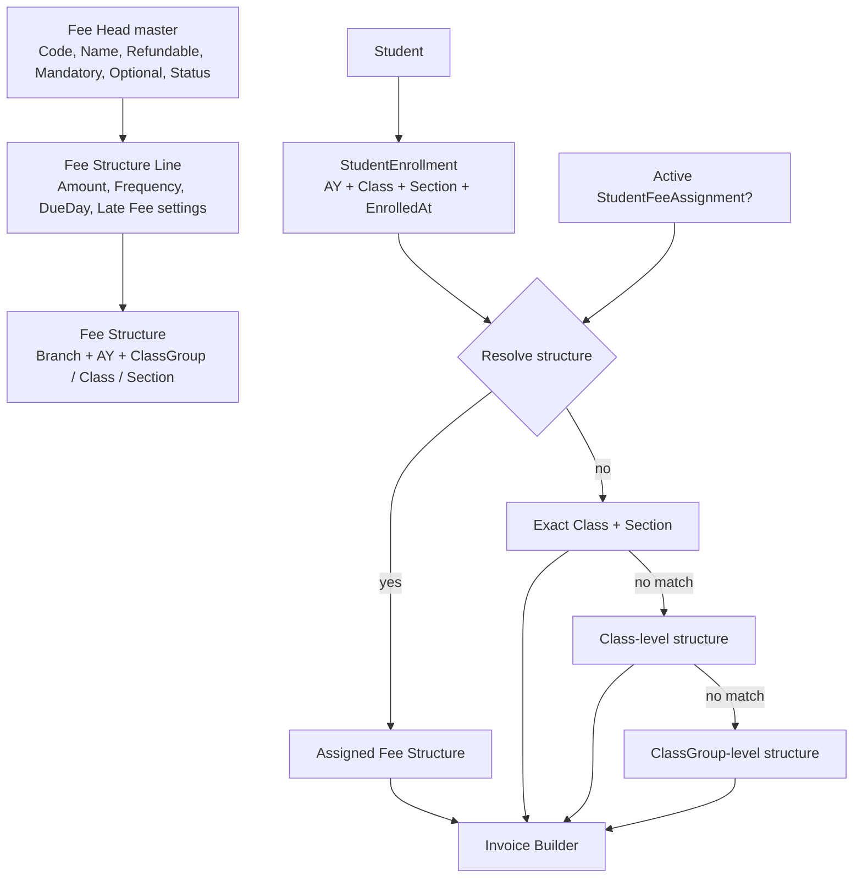

**Important distinction:** the `StudentFeeAssignments` structure override exists in the current source. That does not mean student-specific billing calendars or per-FeeHead amount overrides are implemented. Those are documented future considerations.

---

## 6. Invoice generation — two frequencies, configuration, and period flow

### 6.1 Do not mix these two frequency concepts

There are **two independent frequency settings**. They answer different questions and must remain separate in code, database design, UI and tests.

| Concept | Question it answers | Example values | Where it belongs |
|---|---|---|---|
| **Fee Head / Fee Structure Line Frequency** | How often should this particular charge be applied? | Monthly, Quarterly, HalfYearly, Annual, OneTime | Existing `FeeStructureLine.FeeFrequency` (line-level charge frequency) |
| **Invoice Generation Frequency** | How many billing-period invoices should the school generate in an Academic Year? | Monthly, Quarterly, HalfYearly, Annual | New schedule configuration; not the FeeHead master and not the fee-line amount field |

Example: a school may generate invoices quarterly, while a Tuition line is monthly and an Exam line is half-yearly. The schedule decides the invoice periods; each line's frequency decides whether/how much that line contributes to a particular invoice. Do not rename one field or reuse one enum for both concepts.

### 6.2 Invoice-generation schedule configuration (target design)

The current uploaded ZIP does **not** contain a dedicated invoice-generation schedule configuration entity/table. It only has `FeeFrequency` on `FeeStructureLine`. The Notion Future Consideration page describes configuration scopes as Global, ClassGroup, Class and Section, while global ownership (tenant vs branch) is still open.

Target configuration scope and precedence:

1. Section
2. Class
3. ClassGroup
4. Global fallback

The most specific active configuration wins. Student-specific schedule overrides are explicitly out of current scope. Before implementing the Global row, decide whether Global means tenant-wide or branch-wide; do not silently assume.

Suggested configuration responsibility (design proposal, not existing code):

- `InvoiceGenerationSchedule` (or equivalent): AcademicYearId, scope type, scope reference, GenerationFrequency, active/status and audit fields.
- `GenerationFrequency`: Monthly / Quarterly / HalfYearly / Annual.
- `GenerationTiming`: for now use `StartOfPeriod` as a hardcoded application rule/default; do not add a UI setting until requested.
- Unique/overlap validation must prevent two active schedules at the same scope and AY.
- Resolve schedule through one application service/guard, not separately in each command handler.
- Fee Structure selection remains a separate concern: schedule config decides *when to create invoices*; FeeStructure decides *which students/heads/amounts apply*.

This configuration work is part of the current implementation scope and should be done alongside invoice-generation logic, not postponed as a future enhancement. The exact entity/table name is a proposal and should be checked against the existing schema/migration conventions before coding.

### 6.3 Periods generated for each schedule

The Academic Year `StartDate` anchors the calendar. Do not hardcode April or assume every AY is April–March.

For an example AY of April 2026–March 2027:

| Schedule | Expected invoices | Period labels / period coverage |
|---|---:|---|
| Monthly | 12 | Apr 2026, May 2026, Jun 2026, Jul 2026, Aug 2026, Sep 2026, Oct 2026, Nov 2026, Dec 2026, Jan 2027, Feb 2027, Mar 2027 |
| Quarterly | 4 | Q1: Apr–Jun 2026; Q2: Jul–Sep 2026; Q3: Oct–Dec 2026; Q4: Jan–Mar 2027 |
| HalfYearly | 2 | H1: Apr–Sep 2026; H2: Oct 2026–Mar 2027 |
| Annual | 1 | AY 2026–27: Apr 2026–Mar 2027 |

Period calculation must use the AY's actual StartDate and EndDate. For a non-April AY, the same offsets apply from that AY's start.

### 6.4 Fee-line frequency inside each generated invoice

The schedule determines the invoice periods. The fee-line frequency determines the charge contribution:

- Monthly line: charge for each month covered by the invoice period.
- Quarterly line: charge once in each applicable 3-month cycle anchored to AY StartDate.
- HalfYearly line: charge once in each applicable 6-month cycle anchored to AY StartDate.
- Annual line: charge once in the AY cycle.
- OneTime line: exclude from recurring invoices; use a dedicated use case such as `ADMISSION` where applicable.

**Important amount rule to confirm in implementation tests:** if the invoice schedule is Quarterly and a fee line is Monthly, the quarterly invoice should aggregate the three monthly instalments for that covered quarter (monthly amount × 3); a Quarterly line contributes once; a HalfYearly/Annual line contributes only when its own cycle is due. Do not implement this by merely checking whether the period start month matches the line frequency, because that would undercharge monthly lines on a quarterly invoice. The invoice builder should receive a normalized billing-period start/end and calculate each line's quantity/amount for that period.

### 6.5 Invoice generation timing and manual/automatic modes

- **Current phase:** an authorized user manually triggers invoice generation (single/bulk). There is no automatic recurring invoice job in this phase.
- **Timing rule for now:** generate at the **start of the billing period**. Hardcode `StartOfPeriod` in the application rule for now; no configurable start/end-of-period UI yet.
- **Future:** automatic generation can invoke the same application use case on a scheduler (e.g. Hangfire). Do not create a second invoice calculation path for the scheduled job.
- Manual vs automatic describes *who triggers generation*; Monthly/Quarterly/HalfYearly/Annual describes *which periods exist*. They are not the same setting.

### 6.6 Current code flow in the ZIP

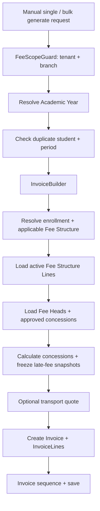

**Current code gap:** `InvoiceBuilder` loads all active lines and does not filter by `FeeFrequency`; it also has no dedicated invoice-generation schedule resolver. `ProrationCalculator` exists but is not wired into the builder. Therefore the ZIP does not yet implement the target period/frequency behavior described above.

### 6.7 Target period-generation flow and first-period gate

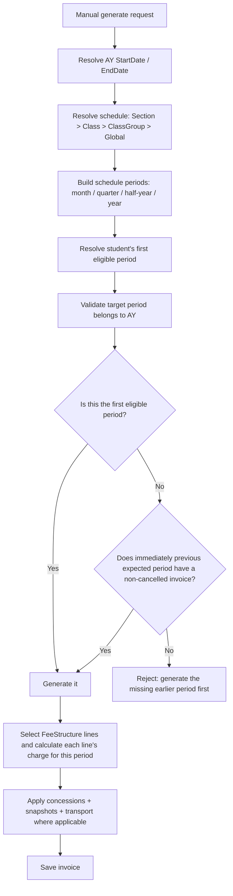

For the current sequential-generation rule, validate the **previous expected invoice period in the resolved schedule**, not every calendar month unconditionally. Thus Monthly schedule checks the previous month; Quarterly checks the previous quarter; HalfYearly checks the previous half-year; Annual has one period. A first eligible period is derived from enrollment and fee applicability. Earlier invoice need not be paid; it only needs to exist and not be cancelled. This gate applies to manual generation now and can be reused by a future scheduler.

### 6.8 Mid-year joining and applicability

The first eligible period must consider `StudentEnrollment.EnrolledAt` (`DateOnly`), optional `LeftAt` (`DateOnly?`), `FeeStructure.ApplicableFrom`, `ApplicableTo`, and AY boundaries, all within tenant/branch scope. A student joining in October must not be forced to generate April–September invoices. The exact proration/catch-up policy for a join partway through a Quarterly/HalfYearly/Annual period remains a business rule to finalize; do not invent it. The existing `ProrationCalculator` is not currently wired into `InvoiceBuilder`.

### 6.9 Example: monthly invoice schedule and fee-line frequencies

For an April 2026–March 2027 AY with a **Monthly invoice-generation schedule**, the system creates up to 12 invoices. On each month's invoice:

- Monthly heads appear every month.
- Quarterly heads appear in April, July, October and January.
- HalfYearly heads appear in April and October.
- Annual heads appear in April.
- OneTime Admission does not appear in recurring monthly invoices; it uses a separate `ADMISSION` invoice.

For the QA structure already created, October recurring amount under a **Monthly invoice schedule** is ₹8,700 before concession/late fee/transport: Monthly ₹4,500 + Quarterly ₹2,400 + HalfYearly ₹1,800. Annual ₹2,600 and OneTime ₹2,500 are excluded from October. This amount example is for monthly invoice schedule; under quarterly schedule, the Monthly line amount must be aggregated for all three months covered by the quarter.


---

## 7. Admission and Registration — keep these separate from recurring bills

### Current code path found in the ZIP

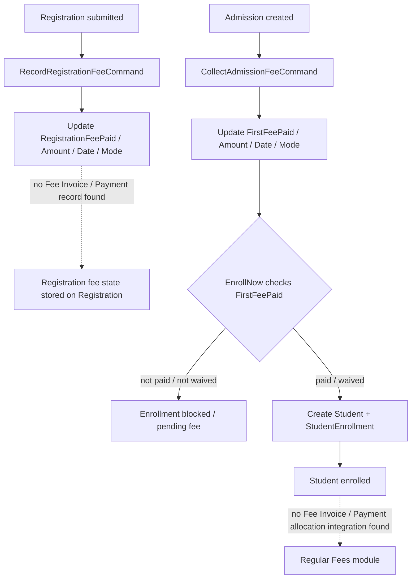

### Target agreed in this chat

```mermaid
flowchart TD
    A[Admission / Enrollment event] --> B[Generate dedicated ADMISSION invoice]
    B --> C[Invoice has OneTime Admission Fee line(s) only]
    C --> D[Collect payment against that invoice]
    D --> E[PaymentAllocation links PaymentId to InvoiceId]
    E --> F[Admission invoice Paid / PartiallyPaid]
    F --> G[Recurring monthly billing starts separately]
    G --> H[OneTime line is never repeated in recurring invoices]
```

The current schema has no `InvoiceType` column. A separate Admission invoice can use a stable `PeriodLabel` such as `ADMISSION` without adding an invoice-type column. Since `PaymentAllocation` links to `InvoiceId`, a one-line Admission invoice is enough to attribute the payment to the Admission fee at invoice level.

**Not yet implemented in ZIP:** a dedicated Admission Invoice command/endpoint that uses Fees `Invoice` / `Payment` / `PaymentAllocation`. Existing Registration and Admission commands only update payment/fee fields on their own Registration/Admission entities. The registration/admission workflow integration needs to call the new fee-invoice flow.

---

## 8. Concession flow

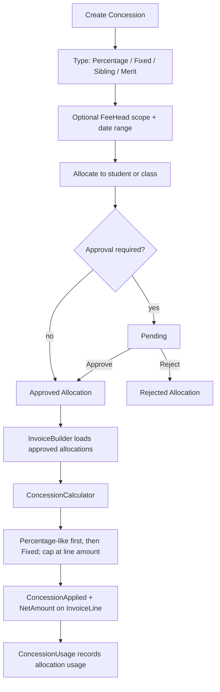

**Current code:** concession create/update/delete, allocate, approve/reject, sibling auto-apply and calculator exist. The invoice builder freezes concession values into invoice lines. Historical invoice line snapshots should not be recalculated from a changed Fee Structure.

---

## 9. Payment collection and wallet flow

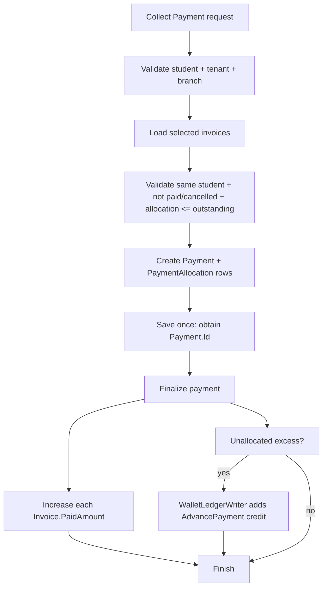

### Advance without invoice

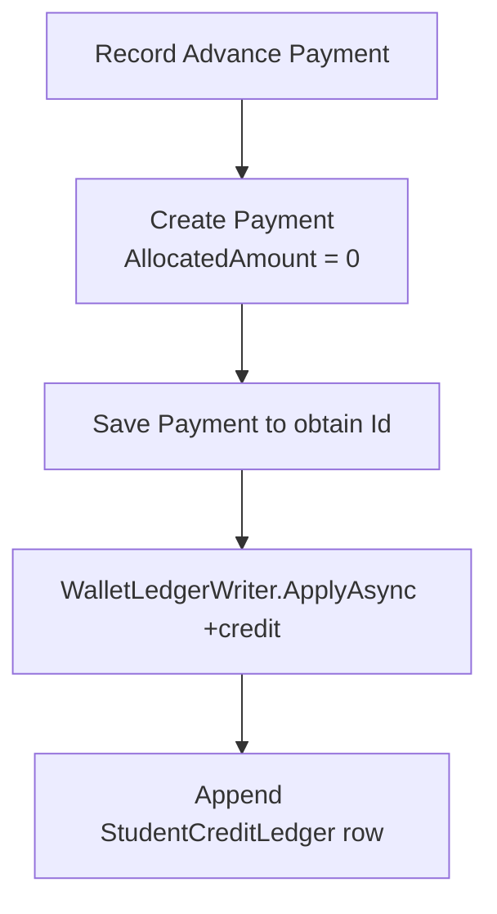

### Apply wallet credit to a bill

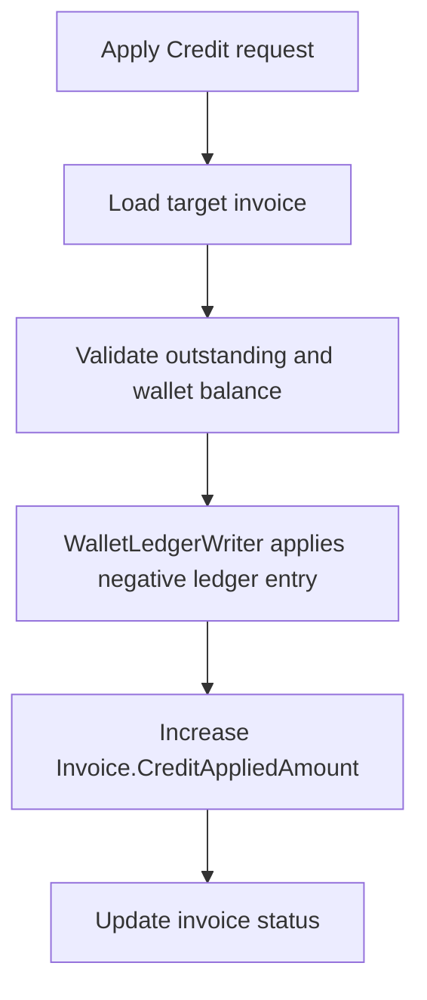

### Other money movement

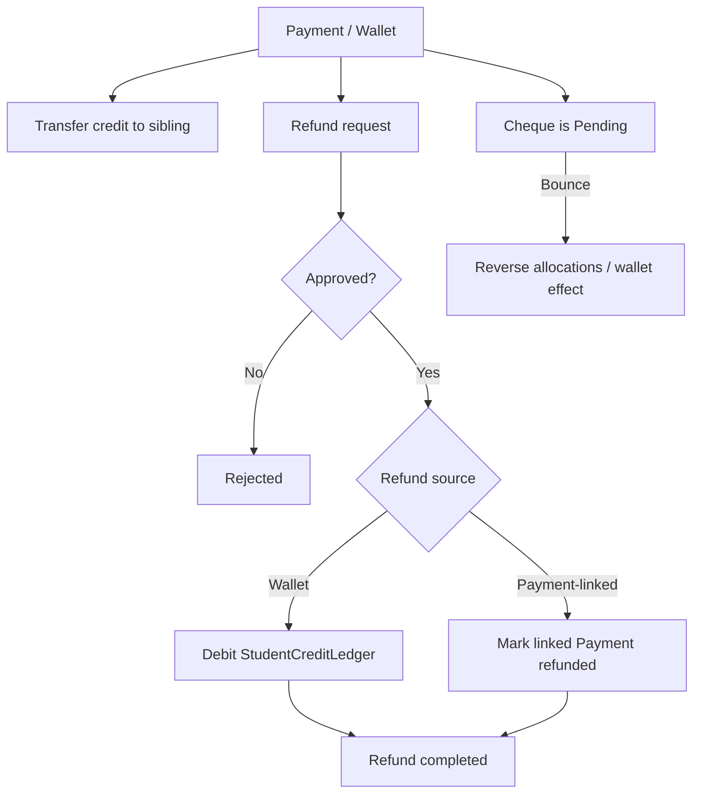

**Data model:** `PaymentAllocation` links `(PaymentId, InvoiceId)` and has `AllocatedAmount`; it does not link directly to `InvoiceLineId` or `FeeHeadId`. `StudentCreditLedger` is append-only and stores signed Amount plus BalanceAfter. Wallet operations lock the Student row (`UPDLOCK`) before reading/appending the ledger.

**Important code-review caveat:** `PaymentCollector.FinalizeAsync` increments `Invoice.PaidAmount` even when Payment.Status is Pending for cheque. The proposed sequential policy says pending cheque should not count as settled. This must be addressed carefully with cheque-bounce reversal and a single consistent settlement calculation before implementing the new collection guard.

### Current payment-allocation scope and sequential collection rule

- **Current phase:** payment allocation is against the **Invoice** only through existing `PaymentAllocation(PaymentId, InvoiceId, AllocatedAmount)`. Do not add direct FeeHeadId or InvoiceLineId payment-allocation records now.
- The invoice contains its FeeHead/InvoiceLine breakdown. The receipt reduces the invoice-level outstanding amount. If the UI/report needs to show how that payment is distributed among heads, calculate that distribution internally using the agreed priority; do not persist separate head-level payment allocations in this phase. Confirm the exact priority rule before coding it. The reviewed source does not evidence persisted per-line paid balances.
- **Future:** direct allocation/reporting and persisted payment attribution against an individual FeeHead or InvoiceLine can be added later if required.
- A later recurring invoice cannot receive payment allocation or wallet credit while an earlier eligible invoice or the student's `ADMISSION` invoice has outstanding balance.
- Apply the same guard in normal collection, CSV bulk collection and `ApplyCreditToInvoice`.
- An unallocated advance sitting in the wallet does not itself settle an invoice.
- Cancelled invoices do not block.
- The multi-invoice single-receipt case remains open: decide whether one receipt may settle the oldest invoice first and then apply the remainder to the next invoice atomically, or whether separate receipts are required.

**Pending-cheque caveat:** the reviewed `PaymentCollector.FinalizeAsync` increases `Invoice.PaidAmount` even when `Payment.Status` is Pending for cheque. Do not count a pending cheque as settled for sequential collection until settlement and bounce reversal are made consistent.

---

## 10. Late fee and overdue flow

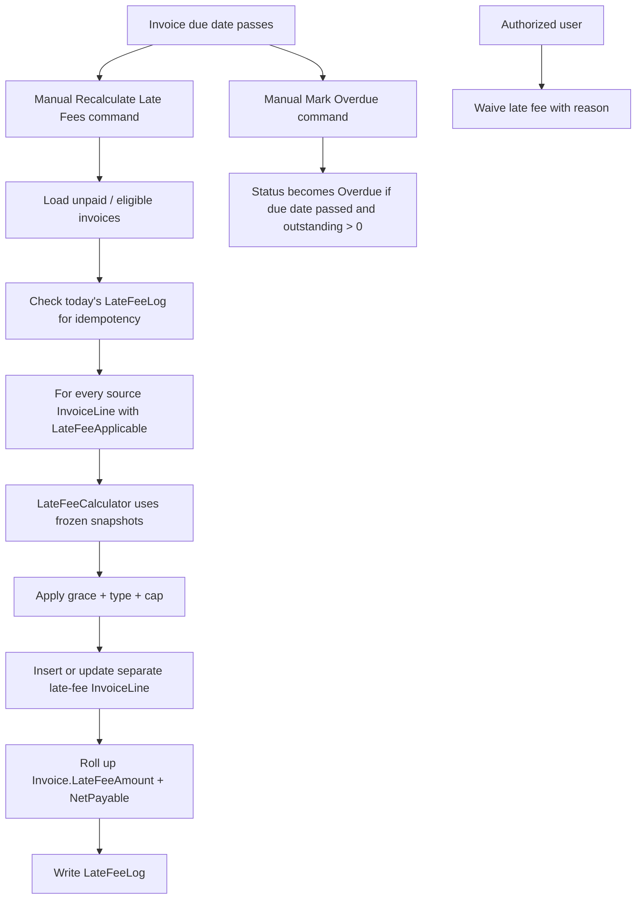

Current late fee types in source: `StagnantFixed`, `Monthly`, `Graduated` (JSON slabs). Snapshots are copied to InvoiceLine at generation. Late fee is added as a separate `InvoiceLine` with `IsLateFeeLine = true` and references the source line.

**Gaps:** Hangfire late-fee / overdue jobs are not found in the ZIP. The `ProrationCalculator` exists but is not wired into `InvoiceBuilder`. The extended monthly late-fee rule about partial months over 15 days needs a separate conformance review. Whole-invoice late-fee calculation from SCH-FEE-95/97 is not evidenced; current model is primarily per source fee line.

---

## 11. Optional fee flow

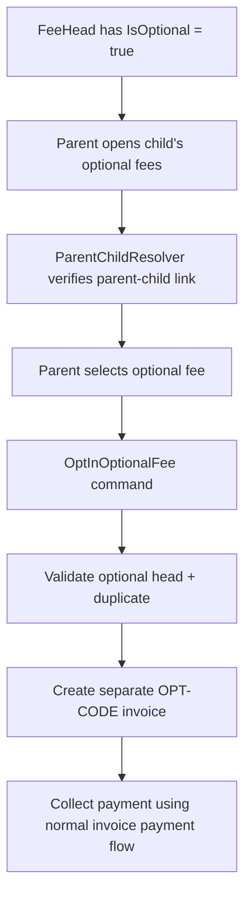

Current code has optional-head lookup and portal opt-in; the period label convention is `OPT-{CODE}`. Optional fees should not be mixed into regular recurring billing unless a separately agreed configuration says so.

---

## 12. Reports, portal and read-side flow

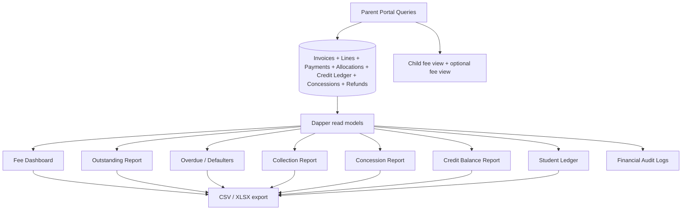

Current report query groups: dashboard, outstanding, defaulters, collection, concessions, credit balances, student ledger, audit logs. The student fee counter is a separate invoice query. CSV/XLSX is evidenced in the implementation; PDF export is not evidenced in the reviewed code.

---

## 13. Entity / table map — what stores what?

| Entity / table | What it stores | Main relationship |
|---|---|---|
| `FeeHeads` | Master charge types | Branch scoped |
| `FeeStructures` | AY + group/class/section scope, dates, status | One structure has many lines |
| `FeeStructureLines` | Head, amount, frequency, due day, late fee rules | Belongs to FeeStructure + FeeHead |
| `StudentFeeAssignments` | Explicit student structure assignment / OverrideAmount | Student + AY + FeeStructure |
| `Invoices` | Bill header, period, totals, status, paid/credit totals | Student + AY + optional FeeStructure |
| `InvoiceLines` | Frozen fee lines and late fee lines | Invoice + FeeHead; self-reference for late fee source |
| `InvoiceSequences` | Atomic branch/AY invoice and receipt sequence | Composite key |
| `Payments` | Receipt-level money received | Student |
| `PaymentAllocations` | Money allocated to invoice | Payment + Invoice composite key |
| `StudentCreditLedger` | Append-only wallet transactions and running balance | Student; optional invoice/payment references |
| `Concessions` | Discount rule | Optional FeeHead scope |
| `ConcessionAllocations` | Student's pending/approved/rejected discount | Student + AY + Concession |
| `ConcessionUsages` | Amount actually consumed per invoice | Allocation + Invoice |
| `LateFeeLogs` | Daily recalculation / waiver trail | Invoice |
| `Refunds` | Refund request and approval lifecycle | Student + optional Payment |
| `FinancialAuditLogs` | Financial change audit | Table name + record ID |

**Financial formulas:**

- `NetPayable = TotalAmount - ConcessionAmount + LateFeeAmount`
- `Outstanding = NetPayable - (PaidAmount + CreditAppliedAmount)`
- `Payment.Amount = Payment.AllocatedAmount + Payment.UnallocatedAmount`

---

## 14. Requirement traceability — complete SCH-FEE coverage

This matrix groups the Notion requirement IDs while keeping every ID visible. Status refers to the uploaded ZIP snapshot, not a claim that a production test has passed.

| Requirement IDs | Requirement area / expected behavior | ZIP status | Notes |
|---|---|---|---|
| SCH-FEE-01 | Fee Head is a distinct charge type | Implemented | FeeHead entity + CRUD |
| SCH-FEE-02 | Fee Head fields (name/code/description/refundable/mandatory/tax) | Partial / scope conflict | Core fields implemented; tax fields intentionally absent under locked no-tax Phase 1 rule |
| SCH-FEE-03 | Fee Head branch ownership | Implemented | Branch-scoped entity |
| SCH-FEE-04 | Default Fee Heads + tenant additions | Implemented | Seed-defaults command exists |
| SCH-FEE-05 | Deactivate head but preserve historical invoices | Implemented | Status + soft delete/guards; verify active-use validation on create/update |
| SCH-FEE-06 | Structure by branch + AY + class + optional section | Implemented | Schema also has ClassGroup scope |
| SCH-FEE-07 | Structure name, AY, class/section, applicable dates | Implemented | ApplicableTo exists in ZIP even though older requirement says optional |
| SCH-FEE-08 | Per-head amount/frequency/due day/late fee configuration | Implemented at data layer | Frequency exists; frequency-driven invoice selection is missing |
| SCH-FEE-09 | Automatic class/section mapping or manual student override | Implemented | StudentFeeAssignment + resolver |
| SCH-FEE-10 | Clone previous AY structure | Implemented | Clone command exists |
| SCH-FEE-11 | Draft/Active/Archived states | Implemented | Status transition command exists |
| SCH-FEE-12 | Generate invoices from student's structure | Partial | Manual single/bulk paths exist; no recurring scheduled job |
| SCH-FEE-13 | One-time/monthly/quarterly/half-yearly/annual generation schedule | Partial / gap | Enum stored, but builder includes all active lines every time; OneTime/admission invoice path absent |
| SCH-FEE-14 | Invoice header fields and totals/status | Implemented | Invoice entity and response exist |
| SCH-FEE-15 | Invoice line items and concessions | Implemented | InvoiceLine snapshots exist |
| SCH-FEE-16 | Bulk invoice generation and daily schedule | Partial | Bulk <=500 exists; Hangfire scheduled job not found |
| SCH-FEE-17 | Manual invoice generation | Implemented | Single student generate endpoint |
| SCH-FEE-18 | Regenerate via cancel old + create new | Implemented | Regenerate command exists; must be rechecked with new sequence policy |
| SCH-FEE-19 | Percentage/fixed/sibling/merit concessions | Implemented | ConcessionType + calculator |
| SCH-FEE-20 | Concession applies to head/invoice/student/group | Partial | FeeHead and student allocation support; class bulk support exists; verify invoice-wide semantics |
| SCH-FEE-21 | Concession fields and date range | Implemented | Entity stores fields |
| SCH-FEE-22 | Approval before use | Implemented | Pending/approve/reject |
| SCH-FEE-23 | Sibling discount | Implemented / verify | AutoApplySiblingConcessions command exists |
| SCH-FEE-24 | Concession history per invoice | Implemented | ConcessionUsage |
| SCH-FEE-25 | Payment against one or multiple invoices | Implemented | PaymentAllocations |
| SCH-FEE-26 | Payment date/amount/mode/reference/notes/collector | Implemented | Payment entity |
| SCH-FEE-27 | Online gateway and webhook | Deferred | No gateway integration evidenced |
| SCH-FEE-28 | Partial payment and invoice outstanding | Implemented | Invoice PaidAmount + CreditAppliedAmount |
| SCH-FEE-29 | Overpayment credit/refund | Implemented at wallet level | Unallocated excess goes to StudentCreditLedger; refund flow exists |
| SCH-FEE-30 | PDF receipt | Partial | Structured receipt JSON exists; PDF deferred |
| SCH-FEE-31 | Bulk CSV payment recording | Implemented | BulkRecordPaymentsCsv |
| SCH-FEE-32 | Payment reconciliation | Deferred | No reconciliation integration evidenced |
| SCH-FEE-33 | Automatic late fee | Partial | Recalculation handler exists but manual-only; no scheduler |
| SCH-FEE-34 | Late fee methods | Implemented / verify | StagnantFixed, Monthly, Graduated; exact legacy wording differs |
| SCH-FEE-35 | Grace period | Implemented | Snapshotted and used by LateFeeCalculator |
| SCH-FEE-36 | Late fee as separate invoice line | Implemented | IsLateFeeLine + SourceInvoiceLineId |
| SCH-FEE-37 | Manual add/waive with reason | Implemented | Manual line + waive command |
| SCH-FEE-38 | Refund for overpayment/withdrawal/refundable heads | Partial | Wallet and payment-linked refund paths; fee-head refundable logic needs verification |
| SCH-FEE-39 | Refund fields | Implemented | Refund entity |
| SCH-FEE-40 | Approval required | Implemented | Approve/reject commands |
| SCH-FEE-41 | Complete refund updates money state | Partial / inspect defect | Wallet debit exists; payment-linked marks Payment Refunded but invoice PaidAmount reversal is not evidenced |
| SCH-FEE-42 | Invoice adjustment with reason/approval | Partial | AdjustInvoiceAmount exists; approval workflow per requirement needs verification |
| SCH-FEE-43 | Due-date reminders | Deferred | Communication integration not wired |
| SCH-FEE-44 | Configurable reminder templates | Deferred | No template integration in Fees code |
| SCH-FEE-45 | Manual reminder trigger | Deferred | No reminder command/controller found |
| SCH-FEE-46 | Communication module handles delivery | Deferred integration | Requirement is a module contract, not wired in ZIP |
| SCH-FEE-47 | Fee dashboard KPIs/breakdowns | Implemented | Dapper dashboard query |
| SCH-FEE-48 | Outstanding report | Implemented | Dapper query |
| SCH-FEE-49 | Overdue report | Implemented | Dapper query |
| SCH-FEE-50 | Collection report | Implemented | Dapper query |
| SCH-FEE-51 | Concession report | Implemented | Dapper query |
| SCH-FEE-52 | Defaulters threshold report | Implemented / verify | Defaulters query exists |
| SCH-FEE-53 | Student ledger | Implemented | Dapper StudentLedger query |
| SCH-FEE-54 | CSV/Excel/PDF exports | Partial | CSV/XLSX evidenced; PDF not evidenced |
| SCH-FEE-55 | Parent/student view of bills, payments, outstanding, receipts | Partial | Parent child fee view + receipt data; online pay deferred |
| SCH-FEE-56 | Parent read-only, cannot edit bills/concessions | Implemented at API surface | ParentChildResolver + read/opt-in permission boundaries |
| SCH-FEE-57 | Push notification | Deferred | No mobile push delivery integration found |
| SCH-FEE-58 | Student status blocks invoice generation | Partial / verify | Student linkage exists; blocked-status guard should be verified in all invoice handlers |
| SCH-FEE-59 | Academic structure class/section link | Implemented | Enrollment/structure fields |
| SCH-FEE-60 | Transport charge integration | Partial | Quote provider exists; generation wiring/frequency consistency gap |
| SCH-FEE-61 | Hostel not applicable | N/A | Removed for School Edition |
| SCH-FEE-62 | Registration fee at registration; Admission fee at enrollment | Partial / mismatch | Registration/Admission records fields, but no Fees invoice/payment integration found |
| SCH-FEE-63 | Examination fee as configurable Fee Head | Implemented | FeeHead + structure mechanism |
| SCH-FEE-64 | Communication reminders/receipt delivery | Deferred | No integration wiring found |
| SCH-FEE-65 | Financial-year management | Superseded / conflict | Phase 1 docs lock Academic Year only, no separate financial-year model |
| SCH-FEE-66 | Audit all financial/structure changes | Partial | Entity/interface exist; writer calls incomplete |
| SCH-FEE-67 | Payment deletion/modification restricted; reversal only | Partial / verify | Soft status/reversal concepts exist; verify each mutation endpoint |
| SCH-FEE-68 | Immutable/exportable financial audit log | Partial / deferred | Read/report path exists; writer implementation missing |
| SCH-FEE-69 | Bulk invoice generation | Implemented | 500-student cap |
| SCH-FEE-70 | Bulk payment CSV | Implemented | BulkRecordPaymentsCsv |
| SCH-FEE-71 | Bulk concession | Implemented | Allocation command supports class/bulk flow |
| SCH-FEE-72 | Bulk reminder | Deferred | No reminder workflow found |
| SCH-FEE-73 | Half-year boundaries from AY start | Partial | Can be calculated, but current builder doesn't select by cycle |
| SCH-FEE-74 | Separate invoice per half-year period | Not implemented in current builder | Current PeriodLabel is caller-provided; no half-year cadence selection |
| SCH-FEE-75 | H1 unpaid balance carried; H2 still generated | Partial / new policy conflict | Invoice-level outstanding exists; no explicit sequence/period guard in ZIP |
| SCH-FEE-76 | Optional block next period if previous fee head unpaid | Not implemented; now revised | Current code has no guard; user now agreed stricter sequential collection and prior-invoice-existence generation |
| SCH-FEE-77 | Clear period labels in ledger | Partial | PeriodLabel stored; format is not strongly normalized/validated in current builder |
| SCH-FEE-78 | Cross-period credit adjustment | Partial | Manual wallet credit application exists; configurable auto-adjust is not wired |
| SCH-FEE-79 | Stagnant/graduated/monthly late fee methods | Implemented | LateFeeCalculator |
| SCH-FEE-80 | Partial month >15 days count full month | Not evidenced | Current Monthly calculation uses month/day logic; this exact rule needs review |
| SCH-FEE-81 | Daily/monthly recalculation updates late fee line | Partial | Manual recalculation endpoint exists, Hangfire jobs deferred |
| SCH-FEE-82 | Maximum late fee cap | Implemented | Per source line cap snapshot |
| SCH-FEE-83 | Partial/full waive with reason | Implemented | WaiveLateFee command |
| SCH-FEE-84 | Registration fee one-time at registration | Partial / integration missing | Registration fee fields/command exist outside Fees invoice/payment records |
| SCH-FEE-85 | Separate registration invoice on submission | Not implemented | No registration-fee Invoice generation integration found |
| SCH-FEE-86 | Registration refundability configurable | Partial | FeeHead refundable flag + refund flow; registration-specific integration not found |
| SCH-FEE-87 | Admission fee separate at admission before first tuition invoice | Not implemented in Fees | Admission has FirstFee fields, but no Fees invoice/payment integration. New chat decision: separate ADMISSION invoice |
| SCH-FEE-88 | Transport amount by route and stop | Implemented in Transport module | Transport has route/stop fee sources |
| SCH-FEE-89 | Fee module reads transport quote | Partial | ITransportFeeQuoteProvider exists |
| SCH-FEE-90 | Transport fee frequency | Partial | Quote contains Frequency but invoice builder does not use it to filter line |
| SCH-FEE-91 | Transport opt-out mid-term proration/refund | Not evidenced / deferred | ProrationCalculator is not wired into InvoiceBuilder |
| SCH-FEE-92 | Transport late fee | Partial | Transport line currently added with late fee disabled in builder |
| SCH-FEE-93 | Route assignment triggers transport fee | Partial | Quote fetched during invoice generation, not verified as automatic structure mutation |
| SCH-FEE-94 | Per-head late fee | Implemented | Current model is per line/head |
| SCH-FEE-95 | Whole-invoice late fee | Not evidenced | Current calculator is per source line |
| SCH-FEE-96 | Configure late fee per Fee Head | Implemented | FeeStructureLine carries late-fee fields |
| SCH-FEE-97 | Whole invoice basis = total outstanding | Not evidenced | Separate whole-invoice calculation mode not found |
| SCH-FEE-98 | Optional heads not auto-added | Implemented | IsOptional flag and separate opt-in flow |
| SCH-FEE-99 | Optional flag on Fee Head | Implemented | IsOptional |
| SCH-FEE-100 | Parent sees optional fees and deadline | Partial | View exists; deadline handling needs verification |
| SCH-FEE-101 | Separate optional invoice or next invoice | Implemented in separate-invoice form | OPT-{CODE} invoice |
| SCH-FEE-102 | Staff can manually add optional fee | Partial / verify | Manual invoice line exists; dedicated staff optional-fee path needs verification |
| SCH-FEE-103 | Optional fee concession | Implemented by shared concession engine, verify policy | Same builder/line concession path |
| SCH-FEE-104 | Optional recurring or one-time | Partial | FeeFrequency exists; opt-in command path and cadence need verification |
| SCH-FEE-105 | Mid-year join proration | Partial / gap | ProrationCalculator exists, not wired into invoice builder |
| SCH-FEE-106 | Withdrawal refund based on date/refundability | Partial | Refund workflow exists; proration calculation not evidenced |
| SCH-FEE-107 | Transport daily proration | Not implemented | Explicitly deferred in Phase 1 docs |
| SCH-FEE-108 | Promotion applies new class structure next AY | Supported by AY-based structure model | Promotion workflow enforcement needs verification |
| SCH-FEE-109 | Monthly/Quarterly/HalfYearly/Annual cycles | Partial | Enum exists, builder doesn't select per frequency |
| SCH-FEE-110 | Split AY into equal periods | Not implemented in generation path | Cycle resolver needed |
| SCH-FEE-111 | Monthly invoice and due day | Partial | DueDay stored; no scheduler / cycle filter |
| SCH-FEE-112 | Quarterly invoice and due day | Not implemented in builder | Frequency schedule not wired |
| SCH-FEE-113 | Two half-year invoices | Not implemented in builder | Frequency schedule not wired |
| SCH-FEE-114 | Annual invoice | Not implemented in builder | Frequency schedule not wired |
| SCH-FEE-115 | Separate invoice per billing period | Partial | One invoice per supplied PeriodLabel duplicate constraint; no period planner |
| SCH-FEE-116 | Generate next even if old outstanding | Mismatch with current conversation decision | User now wants prior invoice generated (not necessarily paid) for generation; for collection, previous must be settled |
| SCH-FEE-117 | Configurable block generation | Current chat adds stricter required rule | New agreed rule: previous expected invoice must exist before next generation |
| SCH-FEE-118 | Auto credit adjustment by tenant config | Not implemented | Manual ApplyCredit exists; auto-adjust not wired |
| SCH-FEE-119 | Late fee independent of billing cadence | Implemented conceptually | Invoice-line snapshots apply regardless of period |
| SCH-FEE-120 | Monthly late fee partial-month rule | Not evidenced | Exact >15 days rule not demonstrated |
| SCH-FEE-121 | Quarterly monthly-late-fee worked example | Needs test | Calculator supports Monthly, exact example should be tested |
| SCH-FEE-122 | Advance payments without invoice | Implemented | Advance payment + wallet ledger |
| SCH-FEE-123 | Advance payment metadata | Implemented | Payment entity stores date/mode/reference/notes/collector |
| SCH-FEE-124 | Advance increases credit balance | Implemented | WalletLedgerWriter append-only positive ledger row |
| SCH-FEE-125 | Auto-adjust credit when new invoice generated | Not implemented | ManualOnly priority; no auto-adjust on generation |
| SCH-FEE-126 | Update invoice status and balance on auto-credit | Partial | Status logic exists in ApplyCredit, not automatic invoice generation |
| SCH-FEE-127 | Manually apply credit to invoice | Implemented | ApplyCreditToInvoice |
| SCH-FEE-128 | Transfer credit between siblings with approval | Partial | Transfer command exists; approval workflow needs verification |
| SCH-FEE-129 | Refund wallet credit | Implemented | Refund wallet debit flow |
| SCH-FEE-130 | Credit balance report | Implemented | Dapper report query |
| SCH-FEE-131 | Student ledger includes wallet movements | Implemented | Dapper StudentLedger query |
| SCH-FEE-132 | Credit expiry by AY/FY | Deferred | Expired enum exists; expiry configuration and job not found |

---

## 15. Current implementation scope, future enhancements, and decisions still open

### 15.1 Current phase — implement now

1. **Invoice-generation schedule configuration:** build the separate schedule config at Global / ClassGroup / Class / Section scope, with precedence Section > Class > ClassGroup > Global. Student-specific schedule override is not in scope. Global ownership (tenant vs branch) must be decided before schema/migration.
2. **Two independent frequencies:** retain `FeeStructureLine.FeeFrequency` for how often a fee head is charged; add a separate `InvoiceGenerationFrequency` for Monthly / Quarterly / HalfYearly / Annual invoice periods.
3. **Academic Year anchoring:** all period boundaries and cycles derive from AY `StartDate` / `EndDate`; no April hardcoding.
4. **Period count:** Monthly = 12 periods; Quarterly = Q1–Q4; HalfYearly = H1–H2; Annual = 1 period, for a 12-month AY. Actual labels/dates derive from AY dates.
5. **Fee-line application:** Monthly, Quarterly, HalfYearly and Annual lines contribute according to their own cadence inside the generated invoice period; OneTime is excluded from recurring invoices. Quarterly schedule must aggregate three monthly charges for a Monthly line, not charge it only once.
6. **Generation trigger:** manual single/bulk invoice generation only. Automatic recurring generation is future work.
7. **Generation timing:** start of each billing period for now, hardcoded as `StartOfPeriod`; no start/end timing setting in UI now.
8. **Sequential generation:** first eligible period may be generated; the next expected period can be generated only when the previous expected period has a non-cancelled invoice. Previous invoice need not be paid. Check periods according to the resolved schedule (month/quarter/half-year/year), not always calendar months.
9. **First eligible period:** derive from enrollment date and FeeStructure applicability/AY bounds. No back-billing before joining. Mid-period proration/catch-up needs an explicit rule.
10. **Admission:** dedicated OneTime `ADMISSION` invoice before recurring billing; collect against that invoice using existing invoice-level PaymentAllocation. Existing Admission fields are not yet integrated with Fees tables.
11. **Payment allocation:** Invoice-level only. Use existing PaymentAllocation. Invoice-internal automatic adjustment among fee lines remains internal to the invoice. No direct FeeHead/InvoiceLine payment attribution now.
12. **Sequential collection:** later invoice allocation/credit is blocked by earlier eligible invoice or Admission invoice outstanding. Apply consistently to normal payment, CSV bulk and wallet-credit application.
13. **Preserve modularity:** one schedule resolver, one billing-period builder, one invoice builder path shared by manual and future scheduled triggers; shared guards for generation and collection.

### 15.2 Copy-paste requirements to add to Notion (not clearly covered as explicit requirements)

The following are proposed requirement statements for the Notion `New Requirement` page. They are deliberately separated from the existing SCH-FEE list so they can receive new IDs during backlog grooming.

**REQ-FEE-NEW-01 — Separate invoice-generation frequency from fee-line frequency**

The system shall maintain two independent frequency concepts: (a) Fee Head / Fee Structure Line frequency, which determines how often a charge is applied, and (b) Invoice Generation frequency, which determines the billing periods for which invoices are created. Changing one shall not implicitly change the other.

**REQ-FEE-NEW-02 — Configurable invoice-generation schedule scope**

The system shall support invoice-generation frequency configuration at Global, ClassGroup, Class and Section scope for an Academic Year. The most specific active scope shall override the less specific scope in this order: Section, Class, ClassGroup, Global. Student-specific schedule overrides are excluded from the current phase. Global ownership shall be explicitly defined as tenant-wide or branch-wide before implementation.

**REQ-FEE-NEW-03 — Academic-Year-based billing periods**

The system shall calculate monthly, quarterly, half-yearly and annual invoice periods from the configured Academic Year StartDate and EndDate. The system shall not assume April as the start month.

**REQ-FEE-NEW-04 — Invoice period count and identity**

For a 12-month Academic Year, Monthly frequency shall produce 12 periods, Quarterly shall produce Q1–Q4, HalfYearly shall produce H1–H2, and Annual shall produce one period. Every invoice shall store a stable period identity/label and start/end dates so duplicate checks, reports and sequential generation use the same period definition.

**REQ-FEE-NEW-05 — Fee-line frequency application within an invoice period**

For every generated invoice, the system shall include each Fee Structure Line only when its FeeFrequency is due within the invoice period. When a Monthly line is billed on a Quarterly invoice schedule, the invoice amount shall include all three monthly instalments covered by that quarter. Quarterly, HalfYearly and Annual lines shall contribute according to their own AY-anchored cycle. OneTime lines shall be excluded from recurring invoices.

**REQ-FEE-NEW-06 — Manual invoice generation in current phase**

In the current phase, authorized users shall manually trigger single-student or bulk invoice generation. Automatic/scheduled invoice generation is excluded. Manual and future scheduled generation shall call the same application use case and business rules.

**REQ-FEE-NEW-07 — Start-of-period generation rule**

Until configurable generation timing is introduced, an invoice shall be generated at the start of its billing period. The timing shall be a single application-level `StartOfPeriod` rule, not a user-editable setting in the current phase.

**REQ-FEE-NEW-08 — Sequential invoice-period generation**

For a student and resolved invoice schedule, the first eligible billing period may be generated. A subsequent period shall not be generated until the immediately preceding expected period has a non-cancelled invoice. The preceding invoice need not be paid. The rule shall follow the schedule's periods (month, quarter, half-year or year), not assume monthly periods for every schedule.

**REQ-FEE-NEW-09 — First eligible period for mid-year enrollment**

The first eligible period shall be derived from StudentEnrollment.EnrolledAt, LeftAt where relevant, FeeStructure.ApplicableFrom/ApplicableTo and Academic Year boundaries. Periods before the student's first eligible period shall not be generated. Proration/catch-up for a join date inside a billing period shall follow a separately approved rule.

**REQ-FEE-NEW-10 — Admission invoice as a separate OneTime invoice**

The Admission Fee shall be invoiced through a dedicated invoice with stable period identity `ADMISSION`, containing the applicable OneTime Admission fee line(s). This invoice shall be generated before recurring tuition billing and shall be paid through the normal invoice payment flow.

**REQ-FEE-NEW-11 — Invoice-level payment allocation for current phase**

In the current phase, PaymentAllocation shall reference PaymentId and InvoiceId only. The payment shall reduce the invoice-level outstanding amount. If a head-wise distribution is shown, it shall be derived internally according to the approved priority and shall not create persisted FeeHeadId/InvoiceLineId allocation records. Direct payment attribution to FeeHeadId or InvoiceLineId is excluded from the current phase.

**REQ-FEE-NEW-12 — Sequential payment/credit allocation**

A payment allocation or wallet-credit application against a later eligible invoice shall be blocked while an earlier eligible invoice or the student's Admission invoice has outstanding balance. The same validation shall apply to single payment collection, CSV bulk collection and ApplyCreditToInvoice. Cancelled invoices shall not block.

**REQ-FEE-NEW-13 — Period-level invoice uniqueness**

The system shall prevent duplicate invoices for the same student, Academic Year, schedule scope and billing-period identity, while preserving tenant/branch isolation. Cancelled invoice regeneration behavior shall be explicitly defined and tested.

### 15.3 Future enhancements — keep out of current implementation

- Automatic recurring invoice generation through Hangfire or another scheduler, reusing the manual generation use case.
- Configurable generation timing (start of period, end of period, custom date/day) and reminders before/after generation.
- Student-specific invoice-generation schedule overrides and student-specific FeeHead amount overrides.
- Direct payment allocation and reporting against FeeHeadId / InvoiceLineId, beyond current invoice-level allocation.
- Automatic wallet-credit adjustment when a new invoice is generated, plus configurable allocation priority and credit expiry job.
- Online payment gateway, webhook verification, settlement reconciliation and gateway refunds.
- Parent payment reminders through SMS/email/WhatsApp and communication templates.
- Automated late-fee and overdue jobs; configurable late-fee schedule and whole-invoice late-fee policy if approved.
- Advanced proration/catch-up for mid-month, mid-quarter and mid-year joins/exits, promotions and route changes.
- Full Registration Fee integration with the Fees Invoice/Payment/PaymentAllocation ledger (decision required whether it is a separate `REGISTRATION` invoice in the same way as Admission).
- Cheque clearing workflow and bounce reversal with consistent invoice outstanding restoration.
- Multi-invoice single-receipt policy (atomic oldest-first allocation vs separate receipts).
- Receipt PDF, richer printable invoice/receipt templates and additional export formats.
- Credit expiry/forfeiture policy and automated expiry processing.
- Full financial audit writer and immutable audit coverage for every financial mutation.
- Transport fee billing-cycle alignment, transport proration and consistent provider wiring across single/bulk/regenerate.
- Advanced reconciliation, accounting/ERP integrations and finance-period closing.

### 15.4 Decisions still required before coding the relevant edge cases

1. Is Global schedule configuration tenant-wide or branch-wide?
2. For a student joining mid-quarter or mid-half-year, charge full cycle, prorate, or start from the next cycle?
3. If one receipt includes multiple invoices, can it allocate oldest-first across periods atomically?
4. What is the exact settlement rule for pending cheques and bounce reversal?
5. Should Registration Fee become a separate `REGISTRATION` invoice now or remain in the Registration module for this phase?
6. For a Quarterly invoice schedule, confirm the proposed aggregation rule for Monthly fee lines (three monthly instalments on one quarterly invoice).
7. When a prior invoice is cancelled, should the same period be regenerated with a new invoice number while retaining the cancelled record? Recommended: retain history and permit one replacement active invoice, enforced by a filtered uniqueness/business guard.


---

## 16. Cross-cutting safety / quality controls

| Concern | Current source finding | Required attention |
|---|---|---|
| Tenant / Branch scope | `FeeScopeGuard` exists | Every query/write path, including student enrollment and structure resolution, must preserve tenant + branch scope |
| RBAC | `HasPermission` exists | In uploaded ZIP, FeeHeads, FeeStructures and Invoices controller actions have `[AllowAnonymous]` with permission attributes commented; this is a security hardening issue |
| Transactions | MediatR `TransactionBehavior` exists | Validate all business rules before first mutation; avoid error returns after writes |
| Invoice numbering | `FeeSequenceGenerator` uses `UPDLOCK, HOLDLOCK` | Preserve atomic branch + AY sequence |
| Wallet concurrency | `WalletLedgerWriter` locks Students row with `UPDLOCK, ROWLOCK` | All wallet-changing operations must use the writer |
| Money math | `Money.Round` centralizes 2dp rounding | Do not add scattered `Math.Round` calls |
| Historical invoice immutability | Snapshot columns and structure edit guard exist | Keep invoice snapshots immutable; never rebuild old invoices from current FeeStructure |
| Payment immutability | Status/reversal approach exists | Do not hard-delete financial history |
| Audit | Entity/interface present; writer incomplete | Finish `IFinancialAuditWriter` before production audit claims |
| Bulk limits | Existing handlers cap bulk at 500 | Preserve the limit and avoid N+1 unbounded work |
| Tests | No Fees test project / test files found in supplied ZIP | Add unit/integration acceptance tests before declaring new billing logic verified |
| Scheduled jobs | Hangfire package is available | Fee recurring generation, reminder and late-fee/overdue jobs are not present in ZIP |

---

## 17. Recommended implementation sequence

Do these in this order to keep the changes modular and testable:

1. **Confirm schedule ownership and define config model:** decide whether Global is tenant-wide or branch-wide; add the Global/ClassGroup/Class/Section schedule config and Section > Class > ClassGroup > Global resolver.
2. **Build billing-period model:** create normalized period identity and start/end dates for Monthly, Q1–Q4, H1–H2 and Annual, all derived from AY StartDate/EndDate.
3. **Separate schedule from fee-line cadence:** add a distinct InvoiceGenerationFrequency; retain `FeeStructureLine.FeeFrequency` for the charge cadence.
4. **Implement period-aware invoice composition:** update `InvoiceBuilder` (or a dedicated composer it calls) to calculate line quantities/amounts for the selected period; exclude OneTime from recurring invoices; test monthly-line aggregation on quarterly invoices.
5. **Manual generation only:** keep single/bulk commands as triggers; hardcode StartOfPeriod; do not add Hangfire recurring generation yet.
6. **First-eligible + sequential generation guard:** resolve enrollment/applicability and require the previous expected schedule period to have a non-cancelled invoice; share across single, bulk and regenerate paths.
7. **Admission invoice use case:** separate OneTime Admission invoice with stable `ADMISSION` period label and integrate the Admission workflow before recurring billing.
8. **Invoice-level payment + sequential collection guard:** keep PaymentAllocation invoice-level; define derived head-wise display/priority if needed; share guard across CollectPayment, BulkRecordPaymentsCsv and ApplyCreditToInvoice; settle cheque and multi-invoice receipt behavior first.
9. **Transport consistency + proration:** align quote frequency across single/bulk/regenerate; wire proration only after mid-period join/exit rules are approved.
10. **Security, audit and tests:** fix accidental AllowAnonymous access, implement audit writer, and add acceptance tests for period counts, amount aggregation, missing/cancelled periods, first eligible period, admission blocking, partial payments, credit, cheque, bulk parity and tenant/branch isolation.
11. **Future separately:** scheduled jobs, reminders, gateway, PDF/export extensions, credit expiry and advanced reconciliation.

---

## 18. Main source references

### Uploaded source

- `src/Application/SchoolERP.Application/Features/Fees/Builders/InvoiceBuilder.cs`
- `src/Application/SchoolERP.Application/Features/Fees/Builders/PaymentCollector.cs`
- `src/Application/SchoolERP.Application/Features/Fees/Builders/ConcessionCalculator.cs`
- `src/Application/SchoolERP.Application/Features/Fees/Builders/LateFeeCalculator.cs`
- `src/Application/SchoolERP.Application/Features/Fees/Builders/ProrationCalculator.cs`
- `src/Application/SchoolERP.Application/Features/Fees/Builders/PeriodLabelBuilder.cs`
- `src/Infrastructure/SchoolERP.Infrastructure/Services/FeeSequenceGenerator.cs`
- `src/Infrastructure/SchoolERP.Infrastructure/Services/WalletLedgerWriter.cs`
- `src/Infrastructure/SchoolERP.Infrastructure/Services/CurrentAcademicYearProvider.cs`
- `src/Infrastructure/SchoolERP.Infrastructure/Services/TransportFeeQuoteProvider.cs`
- `src/API/SchoolERP.API/Controllers/Fees/*Controller.cs`
- `src/Domain/SchoolERP.Domain/Fees/Entities/*`

### Notion pages

- [Fees & Concession — parent](https://app.notion.com/p/37452ed1a68180ee9ca3d6f8777d8e92)
- [New Requirement — SCH-FEE-01 to SCH-FEE-132](https://app.notion.com/p/39c52ed1a681801c9669f7f00d3a5699)
- [Schema](https://app.notion.com/p/39c52ed1a68180529c25d553c83ab6f6)
- [Phase 1 implementation documentation](https://app.notion.com/p/40652ed1a68180268269e49b4f708ecb)
- [Builders / Helpers documentation](https://app.notion.com/p/40652ed1a681803bafe7d5579a5492cf)
- [Student Fees workflow notes](https://app.notion.com/p/3fe52ed1a68180a088e9c7fffa6b2dfd)
- [Future Consideration — student overrides](https://app.notion.com/p/40952ed1a6818097978be5f33b0c5117)

---

## 19. One-sentence mental model

**FeeHead says what the charge is; FeeStructure says who and how much; Invoice freezes what is owed; PaymentAllocation says which bill got paid; Wallet holds unallocated money; Concession reduces a bill; LateFee adds a separate charge; Refund reverses money; Reports and Portal read the financial history.**
